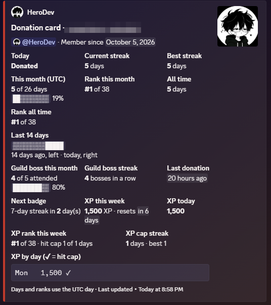
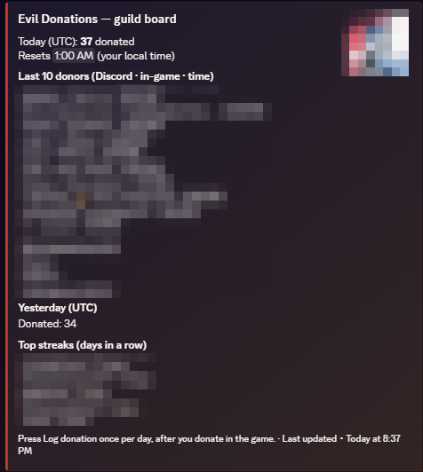
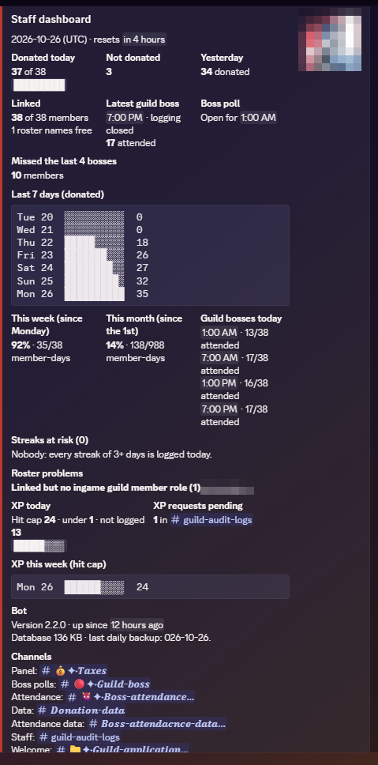

## [Uploading evilbot-showcase.md…]()
Setup

## Run on the PC

1. Install Python and copy this folder to `C:\EvilDonations\`.
2. In that folder: `python -m venv venv`, then `venv\Scripts\pip install -r requirements.txt`.
3. Create `.env` next to `bot.py` (see `.env.example`). Set `DISCORD_TOKEN`, and:
   - `DB_PATH=C:\EvilDonations\donations.db`
   - `BACKUP_DIR=C:\EvilDonations\backups`
   - `ONEDRIVE_BACKUP_DIR=C:\Users\YOU\OneDrive\EvilDonations-backups`
   - `LOG_DIR=C:\EvilDonations\logs`
4. Start it: `powershell -File scripts\run_bot.ps1`.
5. Start at logon: `powershell -File scripts\install_task.ps1`. Also turn on Windows auto-logon so a reboot restarts the bot.

`/stop` (staff) posts the offline notice and ends the bot. Crashes restart after 5 seconds.

## Run on Wispbyte

The live bot runs here. Only one copy may run with the token: stop the PC copy first.

1. Set `DISCORD_TOKEN` in the panel's environment or `.env`. Set `DB_PATH` and `BACKUP_DIR` to paths on the panel's disk.
2. Install with `pip install -r requirements.txt`.
3. Start with `python bot.py`. The panel must restart it after a crash. `scripts\run_bot.ps1` is Windows-only and not used here.
4. Update: `/stop` (posts the offline notice), back up `donations.db`, upload the changed files (e.g. `bot.py`), run `pip install -r requirements.txt`, start again.

`donations.db` and `.env` are not in git. Updates must not overwrite them.

## Tests

`venv\Scripts\python -m pytest`

## Build the .exe (on the dev PC)

`.venv\Scripts\pip install pyinstaller`, then `.venv\Scripts\python -m PyInstaller --onefile --name EvilDonations --noconfirm bot.py`. Result: `dist\EvilDonations.exe`.

## Run the .exe on another PC (64-bit Windows, no Python needed)

1. Make a folder, e.g. `C:\EvilDonations\`. Copy in `EvilDonations.exe`, the `scripts` folder, and your `.env`. To keep the data, also copy `donations.db`.
2. Run `powershell -File scripts\run_bot.ps1`, or `scripts\install_task.ps1` to start at logon.
3. Run the bot on **one** PC at a time. Two copies with the same token will both answer.# EvilBot

A community-management Discord bot that runs 24/7 for an active gaming community.
It tracks member activity, organizes events and gives staff the data they need, all from slash commands.

  
  
  

## Features

- **Member linking:** members request a link to their in-game name, and staff approve it from a roster.
- **Daily activity logging:** staff log one member, several, or everyone at once, for today or yesterday.
- **Member cards:** `/me` shows today's status, streak, this month and rank.
- **XP system:** daily XP cap, cap streaks and a 01:00 UTC reminder for members under the cap.
- **Event polls and attendance:** automatic time polls and a live attendance board.
- **Live data channels:** stats boards that update themselves.
- **Staff tools:** private audit log, link requests, welcome flow, CSV export and on-demand database backup.
- **Reliability:** automatic daily backups, crash restart and versioned releases.

## Tech

Python, discord.py, SQLite, pytest (60+ tests).

4. Windows SmartScreen may warn about an unsigned exe: More info, then Run anyway.

# EvilBot

A community-management Discord bot that runs 24/7 for an active gaming community.
It tracks member activity, organizes events and gives staff the data they need, all from slash commands.

  
  
  

## Features

- **Member linking:** members request a link to their in-game name, and staff approve it from a roster.
- **Daily activity logging:** staff log one member, several, or everyone at once, for today or yesterday.
- **Member cards:** `/me` shows today's status, streak, this month and rank.
- **XP system:** daily XP cap, cap streaks and a 01:00 UTC reminder for members under the cap.
- **Event polls and attendance:** automatic time polls and a live attendance board.
- **Live data channels:** stats boards that update themselves.
- **Staff tools:** private audit log, link requests, welcome flow, CSV export and on-demand database backup.
- **Reliability:** automatic daily backups, crash restart and versioned releases.

## Tech

Python, discord.py, SQLite, pytest (60+ tests).

